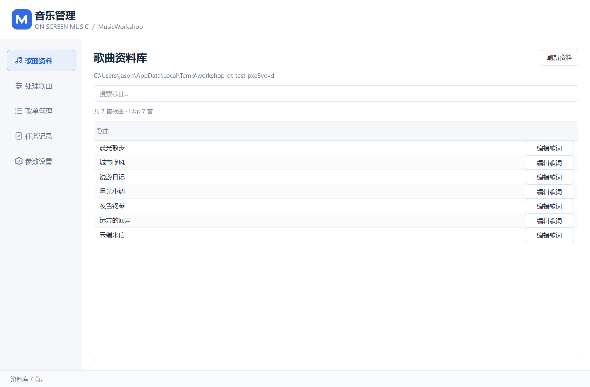

# On Screen Music

一个轻量的 Windows 桌面歌词播放器。**1.1.0 更新新增音乐管理工具 MusicWorkshop**，把歌曲预处理、本地歌词识别、AI 校对、歌词编辑和歌单整理放到同一套软件中。

播放器保持透明、置顶的单行歌词层；音乐管理按需打开，处理完成后在播放器刷新即可读取更新。



## 下载与运行

在本项目的 [Releases](https://github.com/18368311581/OnScreenMusic/releases) 获取 `OnScreenMusic-1.1.0-windows-x64.zip`，完整解压到可写目录。

- `OnScreenMusic.exe`：桌面歌词播放器。
- `MusicWorkshop.exe`：附属的音乐管理工具，也可从播放器托盘打开。
- `MusicWorkshopTool.exe` 与 `MusicWorkshopRuntime`：后台处理与运行文件，保持在原位置即可。

便携包不需要另装 Python；不附带个人歌曲、歌词、歌单、识别模型或 AI 密钥。

> 已完成开发者本机的构建与自动化检查，尚未完成其他电脑验收。建议先备份自己的资料，再在目标 Windows 环境试用。

## 主要功能

| 桌面播放器 | 音乐管理 |
| --- | --- |
| 透明置顶单行歌词，自动缩放长句 | 添加文件、文件夹或选择现有歌曲 |
| 播放、进度、音量、随机选歌与单曲循环 | 统一音频格式与响度、本地识别歌词 |
| 歌单选择、刷新、隐藏与鼠标穿透 | 逐首 AI 校对、参考歌词与重复歌词选项 |
| 物理小键盘快捷键 | 歌词直接编辑、内置试听与点击进度跳转 |
| 启动恢复播放点和窗口位置，保持暂停 | 歌单权重、歌词开关、检查与修复 |
| 无需常驻控制窗口 | 任务终止、工具下载、临时文件清理、深浅色 |

## 准备自己的资料

```text
OnScreenMusic/
├── OnScreenMusic.exe
├── MusicWorkshop.exe
├── MusicWorkshopTool.exe
├── MusicWorkshopRuntime/    # 附属工具运行环境
├── music/                   # MP3，第一层
├── lyrics/                  # 同名 LRC，第一层
└── playlists/               # UTF-8 TXT，第一层
```

歌单每个非空、非注释行使用 `音乐文件名|歌词文件名`；无歌词写 `-`。相同引用重复出现表示随机权重。

```text
示例歌曲.mp3|示例歌曲.lrc
纯音乐.mp3|-
```

进入音乐管理的参数设置，可选择、自动查找或下载 FFmpeg、本地识别程序与模型。下载打开命令行窗口；large-v3 模型约 3.1 GB。AI 校对需要填写自己的接口密钥，并产生对应服务的正常用量。

本地识别不上传音频；在线 AI 校对只发送歌曲名和歌词文本。

**识别或校对整项成功后，最终歌词自动写入对应 LRC，旧文件先备份；失败或终止保留原歌词。** 新素材转换出的 MP3 保存在工作目录，整理后放入 `music`。原始音频不修改、不移动、不删除。

修改资料后，在桌面播放器点击“刷新”。详细操作、备份恢复和升级方法见 [使用说明](docs/USER_GUIDE.md)。

## 快捷键

| 按键 | 功能 |
| --- | --- |
| 左 Ctrl + Num1 / Num3 | 回退／快进 5 秒 |
| 左 Ctrl + Num4 | 下一首；单曲循环时重播当前歌曲 |
| 左 Ctrl + Num5 | 播放／暂停 |
| 左 Ctrl + Num6 | 隐藏／恢复 |

仅左 Ctrl 和物理小键盘有效，NumLock 开关均可。“播放专用”仅响应 Num5。

## 更新与反馈

- [更新记录](CHANGELOG.md)
- [报告问题](https://github.com/18368311581/OnScreenMusic/issues)：请附系统、软件版本和复现步骤，隐藏密钥与私人歌词。
- [构建与验证](docs/BUILDING.md)
- [历史命令与开发参考](docs/REFERENCE.md)

两个部分同目录部署、分别运行，共用 `OnScreenMusic.ini`；播放器仅负责打开附属工具，不承担转码、识别或 AI 推理。

## 许可证

项目自身源码及原创资源采用 [MIT](LICENSE)，Copyright © 2026 Jiang Peichen (Inseven)。

Qt、PySide6、Python、MinGW 等组件遵守各自许可证，不由项目 MIT 许可证替代。发行包附带 `ThirdPartyNotices`；版本、许可及对应源码获取信息见 [第三方组件说明](licenses/THIRD_PARTY.md)。
